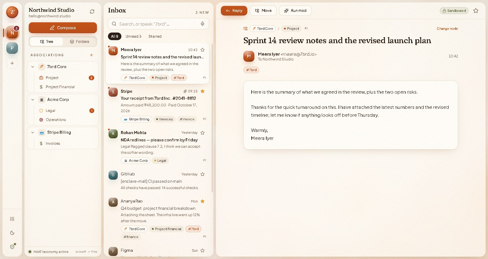
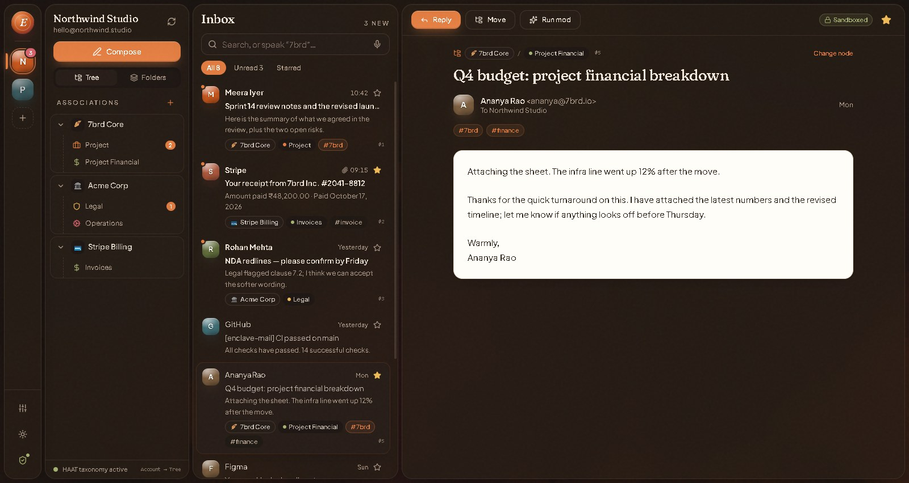
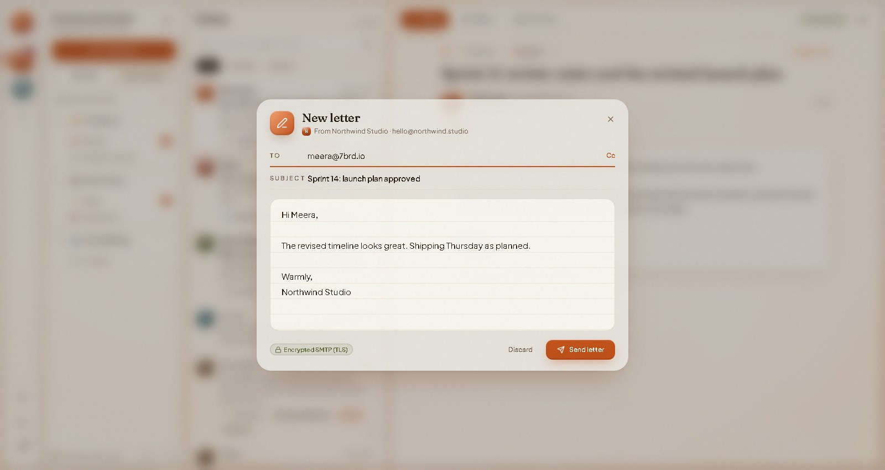
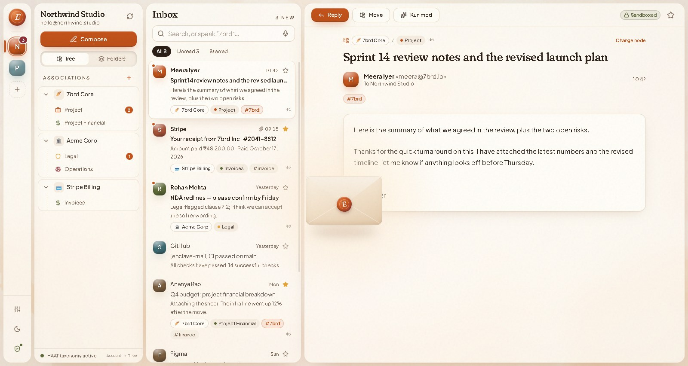
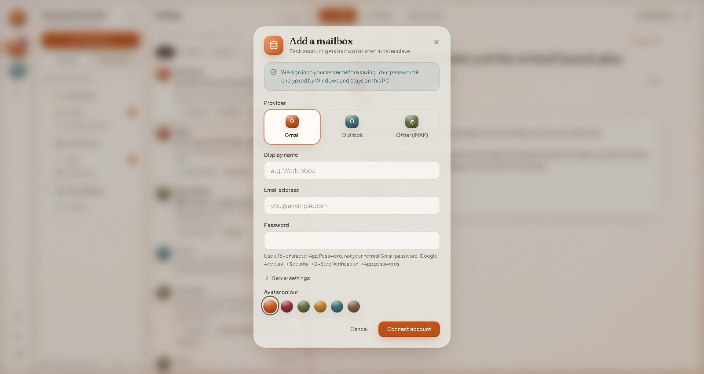
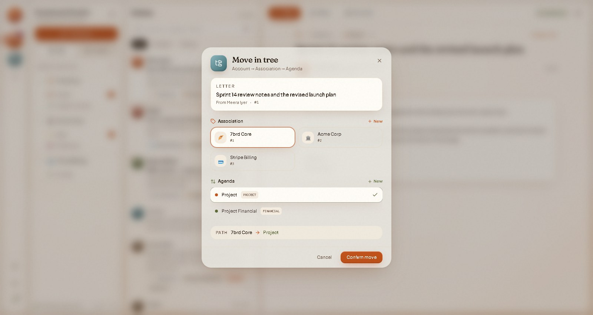

# Enclave Mail — Privacy-First Desktop Email Client

**A free, open-source desktop email client for Windows, built with Electron, React and TypeScript.** Every account lives in its own isolated local "enclave", new mail arrives instantly over IMAP IDLE, and sending uses SMTP over TLS. It is a lightweight, moddable **Thunderbird alternative** with a warm, modern interface.




---

## Features

### Private by design
- **Isolated account enclaves.** Each mailbox gets its own folder of local data, so accounts never mix.
- **Your password stays on your PC.** Passwords are encrypted with the operating system's keychain (Electron `safeStorage`) and never reach the user interface.
- **Sandboxed reader.** HTML email is cleaned with DOMPurify before display: scripts, iframes, forms and inline event handlers are stripped.
- **No telemetry, no cloud.** The app talks only to your own mail servers. Fonts are bundled, so it doesn't call Google Fonts or any CDN.

### Fast, live sync
- **Instant new mail with IMAP IDLE.** One connection per account stays open and the server pushes new messages as they arrive. No refresh button needed.
- **Incremental sync.** Only messages the app has never seen are downloaded. A sync with nothing new takes about 2 seconds instead of re-downloading the whole mailbox.
- **Automatic reconnects.** Dropped connections recover on their own, retrying with a growing delay.
- **Reliable sending.** SMTP over TLS (ports 465 and 587) with sensible timeouts. The server's reply, including its queue ID, is shown after each send so you can trace delivery with your host.

### Organise mail your way
- **Association tree.** File mail under Account → Association (client or project) → Agenda (Project, Financial, Legal…), not just folders.
- **Custom ordering.** Pin and reorder messages and associations by hand.
- **Voice search.** Say a keyword, or "inbox" / "sent" / "starred", to filter or jump between folders.
- **Automation mods.** Local rules ("if subject contains *receipt*, tag *invoice*") that run entirely on your machine.

### A warm, modern interface
- Light cream and espresso dark themes, with a circular reveal when you switch between them.
- A soft WebGL light field behind frosted-glass panes, paper grain, and Fraunces + Plus Jakarta Sans type.
- Motion throughout: a glide between selections, word-by-word headlines, skeleton loaders while mail loads, and spring-animated dialogs.
- A **send animation**: your letter folds into an envelope, gets a wax seal and flies off.
- A compact, responsive layout that works from 960 px wide upwards, and respects your system's "reduce motion" setting.

---

## Screenshots

| Dark theme | Composer |
|---|---|
|  |  |

| Send animation | Add a mailbox |
|---|---|
|  |  |

| Association tree |  |
|---|---|
|  |  |

> Screenshots use fictional demo data.

---

## Quick start

Requirements: **Node.js 20+** and **pnpm**.

```bash
git clone https://github.com/AakashBhat1/enclave-mail-desktop-email-client.git
cd enclave-mail-desktop-email-client
pnpm install
pnpm dev        # runs the app with hot reload
```

Production build (renderer and Electron main process):

```bash
pnpm build
```

> There is no installer (`.exe`) yet; run the app from source for now.

## Connecting an account

| Provider | What to enter |
|---|---|
| **Gmail** | Your address and a 16-character **App Password**, not your normal password. Create one at Google Account → Security → 2-Step Verification → App passwords. |
| **cPanel / any IMAP host** | Choose *Other (IMAP)*. The server fills in as `mail.yourdomain.com`, using IMAP 993 (SSL) and SMTP 465 (SSL). Adjust under *Server settings* if your host differs. |
| **Outlook / Microsoft 365** | Microsoft blocks password sign-in for most accounts; OAuth2 support is on the roadmap. |

The app signs in to both IMAP and SMTP before it saves anything, so a typo is caught straight away.

---

## Architecture

```text
src/
├── main/                     Electron main process (Node)
│   ├── index.ts              Window, IPC handlers, live-update events
│   ├── preload.ts            Context-isolated bridge (window.electronAPI)
│   └── engine/
│       ├── imap-sessions.ts  One persistent IMAP connection per account (IDLE, reconnect)
│       ├── imap-service.ts   Incremental UID sync with imapflow + mailparser
│       ├── smtp-service.ts   Sending with nodemailer (TLS, timeouts, server receipt)
│       ├── account-service.ts  Add / sync / send orchestration, error messages
│       ├── storage-service.ts  Per-account local storage under ~/.enclavemail
│       ├── credential-store.ts Passwords encrypted with Electron safeStorage
│       └── mod-engine.ts     Local automation rules
└── renderer/                 React 19 + Tailwind UI
    ├── App.tsx               Workspace layout and state
    ├── components/           Dock, tree nav, message list, reading pane, modals
    │   ├── fx/               WebGL light field, 3D envelope, send animation, skeletons
    │   └── ui/               Modal, toast, theme toggle, avatars
    └── lib/                  Theme, motion presets, date formatting
mods/                         Example automation script
```

**Tech stack:** Electron 34 · React 19 · TypeScript · Vite 6 · Tailwind CSS 3 · Motion · imapflow · nodemailer · mailparser · DOMPurify

---

## Roadmap and known limitations

Enclave Mail is **alpha** software. Things it does not do yet:

- Read and star changes stay local; they aren't sent back to the server as `\Seen` / `\Flagged` flags.
- Only the newest 50 messages per folder are synced; there's no server-side search or paging yet.
- Attachments are listed but can't be downloaded yet.
- Remote images in HTML email are not blocked yet, and an email's own styles aren't isolated from the app. Both are planned, through a sandboxed iframe reader.
- Outlook / Microsoft 365 needs OAuth2.
- No packaged installer or automated tests yet.

## Contributing

Issues and pull requests are welcome. Use **pnpm** and conventional commit messages (`feat:`, `fix:`, `refactor:`…), and run `pnpm build` before opening a PR.

## License

MIT, as declared in `package.json`.
