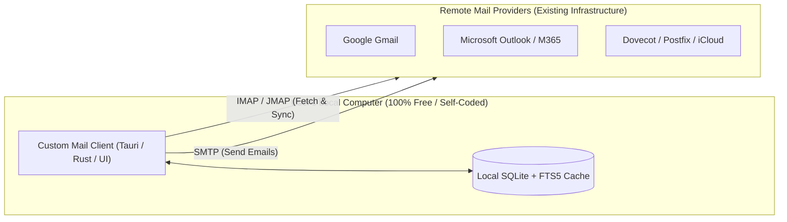

> **Links:** [[../../Welcome|Project root]] | [[overview|Topic Overview]] | [[../../../Style DNA|Style DNA]] | [[../../../../Welcome|Vault index]]
> **Session Chain:** **Session 01 (Current)**

# Session 01: Feasibility and Architecture Breakdown

**Topic:** [[overview|Self Coded Mail Client]]  
**Date:** 2026-10-17 20:26  
**Participants:** User, AI Assistant  
**Focus:** Exploring if building a custom free email client like Thunderbird is realistic, architectural requirements, protocols, and viable implementation paths.  

---

## 1. Executive Summary & Breakthroughs
- **Primary Question:** Can an individual developer or small team realistically build a self-coded, 100% free-to-use mail system/application comparable to Mozilla Thunderbird?
- **The Verdict:** **YES, 100% realistically achievable** — provided we define the application as a **Mail User Agent (MUA - Desktop Email Client)** rather than a public **Mail Transfer Agent (MTA - Email Hosting/Delivery Server)**. Thunderbird itself is a client, not an email provider.
- **The Core Breakthrough:** Thunderbird is burdened by 20+ years of legacy Mozilla Gecko/XUL C++ code. Today, modern frameworks (e.g., **Tauri + Rust** or **Electron/Node**) combined with battle-tested protocol libraries make building a clean, lightning-fast, ultra-secure personal email client vastly easier and lighter than Thunderbird ever was, with zero recurring server hosting costs.

---

## 2. Spoken Conversation & Dialogue Transcript

### User
> "Ok so what I want to talk about is can we realistically make our own like self coded mail system application that is completely free to use like Thunderbird? Tell me about it."

### Assistant
> "Yes, absolutely! But to give you the honest, grounded truth, we must immediately clarify a critical distinction that trips up 90% of people: **Email Client (MUA)** vs **Email Server (MTA)**.
> 
> Mozilla Thunderbird is an **Email Client (Mail User Agent)**. It doesn't host mailboxes or run mail delivery servers; instead, it installs on your computer and connects to existing email accounts (Gmail, Outlook, Yahoo, iCloud, Proton Mail Bridge, or your own domain) using standard protocols like **IMAP** and **SMTP**.
> 
> Because it is a local desktop application, **it costs exactly $0 to run and distribute**. You have zero server infrastructure bills, zero database hosting costs, and complete privacy because the user's emails live on their own machine.
> 
> If instead you wanted to build an entire email delivery server from scratch (like Gmail itself), that is where you hit an administrative nightmare—not because of the code, but because big providers block individual server IPs with spam blacklists, DKIM/SPF/DMARC hurdles, and PTR record requirements.
> 
> But if your goal is an **open-source, 100% free desktop application like Thunderbird**, you can absolutely build it. In fact, you can make something significantly faster, cleaner, and less bloated than Thunderbird by leveraging modern tech stacks like **Tauri + Rust** or **TypeScript + SQLite**."

---

## 3. Core Concepts & Ideation Details

### 3.1 Client (MUA) vs Server (MTA) Clarification

### 3.2 The Five Core Subsystems of a Mail Client
Building an email client involves 5 specific engineering pillars:

1. **Protocol & Sync Engine (IMAP / SMTP / JMAP)**:
   - **IMAP (RFC 3501):** Connecting to remote mailboxes, listing folders, fetching UID lists, fetching headers, downloading bodies, listening for real-time changes via `IMAP IDLE`.
   - **SMTP (RFC 5321):** Authenticating and dispatching outbound emails over port 587 (STARTTLS) or 465 (SSL).
   - **Modern Protocol (JMAP - RFC 8620):** Used by Fastmail and modern servers; JSON-based, vastly easier than IMAP.
   - *Rule of Thumb:* Never write an IMAP parser from raw TCP sockets. Use a vetted library (e.g., `async-imap` in Rust, `imapflow` in Node, `go-imap` in Go).

2. **MIME & Message Decoding Engine**:
   - Emails are notoriously messy. They contain nested multipart structures (`multipart/alternative`, `multipart/mixed`, `multipart/related`).
   - Must handle legacy encodings: Base64, Quoted-Printable, UTF-7, ISO-8859-1, Windows-1252.
   - Inline CID attachments (e.g. ``) mapped to local attachment blobs.
   - Handling Outlook's legacy proprietary `winmail.dat` (TNEF files).

3. **Local Persistence & Search Index (Offline First)**:
   - High-performance email clients do **not** query IMAP on every click. They synchronize messages into a local database.
   - **SQLite with FTS5 (Full-Text Search):** Instant search across 100,000+ emails in sub-10 milliseconds without needing network access.
   - Blob storage for attachments on disk rather than bloating the database.

4. **HTML Rendering & Security Sandbox**:
   - **The Biggest Danger in Email Clients:** An email is untrusted HTML from unknown senders.
   - If not sandboxed, malicious emails can run JavaScript, execute Cross-Site Scripting (XSS), steal local tokens, or trigger tracking beacons.
   - **Thunderbird's Security Model:**
     - External remote images blocked by default (prevents read-receipt tracking).
     - JavaScript completely stripped / disabled.
     - Sandboxed `<iframe>` with strict Content Security Policy (`sandbox="allow-same-origin"` with no script execution).
     - Link tracking preview and phishing warnings for mismatched URLs.

5. **User Interface & Interaction Layer**:
   - 3-pane layout (Folder Tree -> Message List / Threads -> Reading Pane).
   - Rich Text / Markdown Email Composer with drag-and-drop attachments.
   - Keyboard-first shortcuts (Vim / Gmail navigation keys: `j`, `k`, `e`, `r`, `/`).

### 3.3 Tech Stack Options Compared

| Feature / Metric | Stack A: Tauri v2 + Rust (Recommended) | Stack B: Electron + TypeScript | Stack C: Go + Wails | Stack D: Flutter Desktop |
|---|---|---|---|---|
| **Memory Footprint (Idle)** | **~35MB - 60MB RAM** (Lightweight) | ~250MB - 450MB RAM (Heavier) | ~50MB - 80MB RAM | ~80MB - 120MB RAM |
| **Binary Size** | **~15MB** | ~85MB - 120MB | ~25MB | ~35MB |
| **Protocol Libraries** | Excellent (`async-imap`, `lettre`, `mail-parser`) | Huge ecosystem (`imapflow`, `mailparser`, `nodemailer`) | High performance (`go-imap`, `go-message`) | Community packages |
| **Local DB Engine** | SQLite (via `rusqlite` / `sqlx` + FTS5) | `better-sqlite3` + FTS5 | `modernc.org/sqlite` | `sqflite_common_ffi` |
| **Development Speed** | Fast (Web frontend + Rust backend) | Very Fast | Fast | Moderate |
| **Verdict** | **Best for modern Thunderbird replacement** | Best for rapid hackathon MVP | Great for CLI/minimalists | Good if targeting mobile later |

---

## 4. Trade-offs & Alternatives Explored

### Option 1: Native Desktop Client (Thunderbird model)
- **Pros:** Completely offline-capable, private, zero recurring hosting cost, multi-account aggregation, native OS notifications.
- **Cons:** Must handle cross-platform packaging (Windows `.msi`/`.exe`, macOS `.dmg`, Linux `.AppImage`).
- **Feasibility:** **Extremely High.**

### Option 2: Self-Hosted Webmail (Roundcube / SnappyMail model)
- **Pros:** Accessible from any browser, any device.
- **Cons:** Requires a running VPS server, domain name, SSL certificates, ongoing maintenance.
- **Feasibility:** High, but incurs monthly server fees.

### Option 3: Full Mail Provider Server Stack (Postfix + Dovecot from scratch)
- **Pros:** You own the domain and server completely.
- **Cons:** Constant fight with Gmail/Outlook spam filters, reverse DNS configuration, blacklists, high operational burden.
- **Feasibility:** Low recommendation for personal daily driver unless you enjoy server sysadmin chores.

---

## 5. Decisions Made & Action Items
- [x] Identified that building an open-source, free personal email client (MUA) is completely realistic and cost-free.
- [x] Defined the 5 critical engineering subsystems (IMAP sync, MIME parser, SQLite FTS5, HTML sandbox, 3-pane UI).
- [ ] Determine the preferred development stack (Tauri v2 + Rust vs Electron + TypeScript).
- [ ] Outline the Phase 1 Minimal Viable Prototype (MVP): Connect to 1 IMAP account, list folders, display recent 20 emails.

---

## 6. Context Continuity & Next Session Agenda
- **Pointers for next session:** 
  1. Which tech stack do we want to scaffold (e.g. Tauri v2 vs Electron)?
  2. How to handle OAuth2 authentication for Gmail and Outlook vs standard App Passwords?
  3. Designing the database schema for local message caching and threading.
- **Related Sessions:** None (First session in topic)
