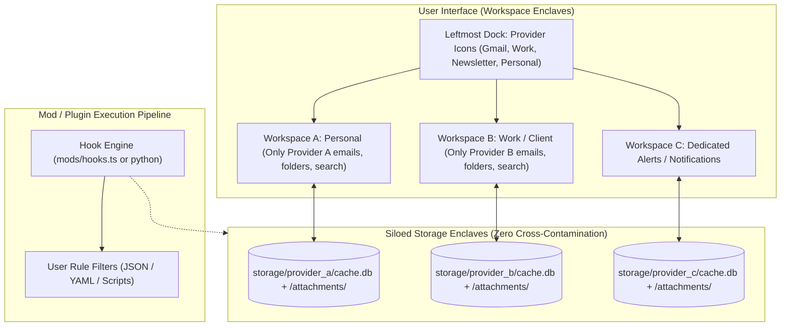

> **Links:** [[../../Welcome|Project root]] | [[overview|Topic Overview]] | [[../../../Style DNA|Style DNA]] | [[../../../../Welcome|Vault index]]
> **Session Chain:** [[session_01_feasibility-and-architecture-breakdown|Session 01]] -> **Session 02 (Current)**

# Session 02: Provider Isolation and Moddable Architecture

**Topic:** [[overview|Self Coded Mail Client]]  
**Date:** 2026-10-17 20:32  
**Participants:** User, AI Assistant  
**Focus:** Designing strict provider/account isolation, custom routing rules, and a moddable/hackable architecture for a personal email client.  

---

## 1. Executive Summary & Breakthroughs
- **The Core User Need:** The user receives many different types of emails across multiple providers and wants **strict provider isolation** (where a provider's mail is stored and displayed in an isolated space where *only* that provider is visible) and high **moddability** (the ability to hack, customize, and write custom logic without battling restrictive corporate software).
- **The Breakthrough:** Traditional clients (Thunderbird, Outlook) default to messy unified views and have rigid, locked-down add-on ecosystems. A custom-coded client can implement **Workspace-Based Provider Enclaves** (analogous to Discord servers or browser profiles) where each provider has its own physically isolated SQLite database, separate UI workspace, and a clean **Plugin / Hook Pipeline** (`on_receive`, `custom_filters`, `theme_mods`).

---

## 2. Spoken Conversation & Dialogue Transcript

### User
> "Yes I meant a email client not a hosting provider. Like I am getting many different type of mail, what I want is a mail from a provider to be stored in a place where only that provider is shown. I mean I want to basically mod it."

### Assistant
> "That completely sharpens the entire vision! That is actually one of the biggest flaws with Thunderbird and Apple Mail:
> 
> 1. **The Messy Clutter Problem:** Standard clients love to push 'Unified Inboxes' where all your accounts, newsletters, work emails, and personal threads are dumped into one giant soup.
> 2. **The Inflexible 'Locked-In' Architecture:** In Thunderbird, writing an add-on or modifying how emails are stored requires navigating Mozilla's convoluted MailExtension APIs, which break every few releases.
> 
> What you are describing is a **Moddable, Enclave-Based Mail Client**:
> - **Strict Provider Siloing:** Each email account/provider gets its own dedicated workspace. When you are looking at Provider A, **only** Provider A exists. Its storage, its search, its folder tree, and its cache are completely separate.
> - **Physical Storage Isolation:** Instead of one giant database, Provider A has its own isolated SQLite database (or local `.eml` / Markdown folder), so you can even back it up or delete it independently.
> - **Total Moddability:** Because you own the codebase, you can expose simple user hooks (e.g. a `mods/` folder where you can drop JavaScript/Python scripts, custom CSS themes, or rule pipelines) to handle and route emails exactly how you want."

---

## 3. Core Concepts & Ideation Details

### 3.1 Workspace Enclave Architecture (The Discord / Slack Model for Email)
Instead of a traditional flat folder tree with all accounts jumbled together, the UI uses **Isolated Workspaces**:



### 3.2 What Makes It "Moddable"? (The Hackable Layer)

When you code your own client, you aren't restricted by Mozilla or Microsoft's rules. You can build a first-class **Mod System**:

#### 1. Hookable Event Pipeline (`mods/`)
A simple folder where you can drop script files:
```javascript
// Example: mods/route_invoices.js
export function onReceiveEmail(email, provider) {
    if (provider.id === 'work_provider' && email.subject.includes('Invoice')) {
        // Automatically save attachment to a specific local folder
        email.attachments.forEach(att => saveToDisk(`C:/Finance/Invoices/${att.name}`));
        // Apply custom tag
        return { tag: 'Finance', markRead: false };
    }
}
```

#### 2. Format Modding (e.g., Email-to-Markdown / Obsidian Sync)
- Because you are building the client, you can mod how emails are saved locally.
- For example: Automatically convert incoming newsletters or receipts into clean `.md` Markdown files and save them straight into your local notes or document folders!

#### 3. Custom UI Mods & Themes
- A `themes/` directory where you can drop standard CSS or JSON color palettes.
- Hotkey remapping: Define custom keyboard shortcuts for quick archiving, tagging, or triggering external scripts.

#### 4. Physical Storage Isolation
```text
C:\Users\You\.mymail\
├── config.json                     <-- Account credentials (stored securely via OS keychain)
├── mods/                           <-- Your custom user scripts
│   ├── on_receive.js
│   ├── custom_filters.json
│   └── styles.css
└── providers/
    ├── google_personal/
    │   ├── local_cache.db          <-- Isolated SQLite database
    │   └── attachments/            <-- Isolated files
    ├── outlook_work/
    │   ├── local_cache.db          <-- Isolated SQLite database
    │   └── attachments/
    └── custom_imap_server/
        ├── local_cache.db
        └── attachments/
```

---

## 4. Architectural Trade-offs for Moddability

| Approach | How it Works | Pros | Cons |
|---|---|---|---|
| **Approach 1: Scripting via TypeScript / JavaScript (Node/Deno)** | Mods are simple JS/TS files loaded at runtime in a sandboxed worker. | Easiest to write, familiar web syntax, instant hot-reloading. | Requires sandbox protection so bad scripts don't crash the app. |
| **Approach 2: Python Scripting Hooks** | The app triggers external Python scripts passing email data as JSON via stdio. | Extremely powerful for data science, local AI (Ollama/LLMs), and OS file manipulation. | Requires Python runtime installed on the user machine. |
| **Approach 3: Declarative JSON/YAML Rules** | Config-based filters (`match: { from: "@github.com" }, action: "tag:dev"`). | Zero coding required, impossible to crash, ultra-fast. | Limited logic for complex custom workflows. |

**Recommended Solution:** A **Hybrid Model** — provide declarative JSON rules for standard filtering, plus a JavaScript/TypeScript hook file for power-user scripting.

---

## 5. Decisions Made & Action Items
- [x] Defined the core product differentiator: **Strict Provider Isolation (Enclaves)** + **Zero-Bloat Moddable Architecture**.
- [x] Established that each provider operates in its own dedicated UI workspace and isolated SQLite database.
- [x] Designed the modding architecture (scriptable hooks, local attachments, custom CSS styling, and export-to-Markdown).
- [ ] Choose the foundation framework (Tauri v2 + Rust vs Electron + TypeScript).
- [ ] Draft the initial SQLite schema for an isolated provider cache (`messages`, `threads`, `folders`, `attachments`).

---

## 6. Context Continuity & Next Session Agenda
- **Pointers for next session:** 
  1. What specific mods or custom rules do you want to run first (e.g., auto-organizing specific senders, saving attachments to custom folders, or custom themes)?
  2. Shall we sketch out the workspace UI layout and database schema?
- **Related Sessions:** [[session_01_feasibility-and-architecture-breakdown|Session 01]]
