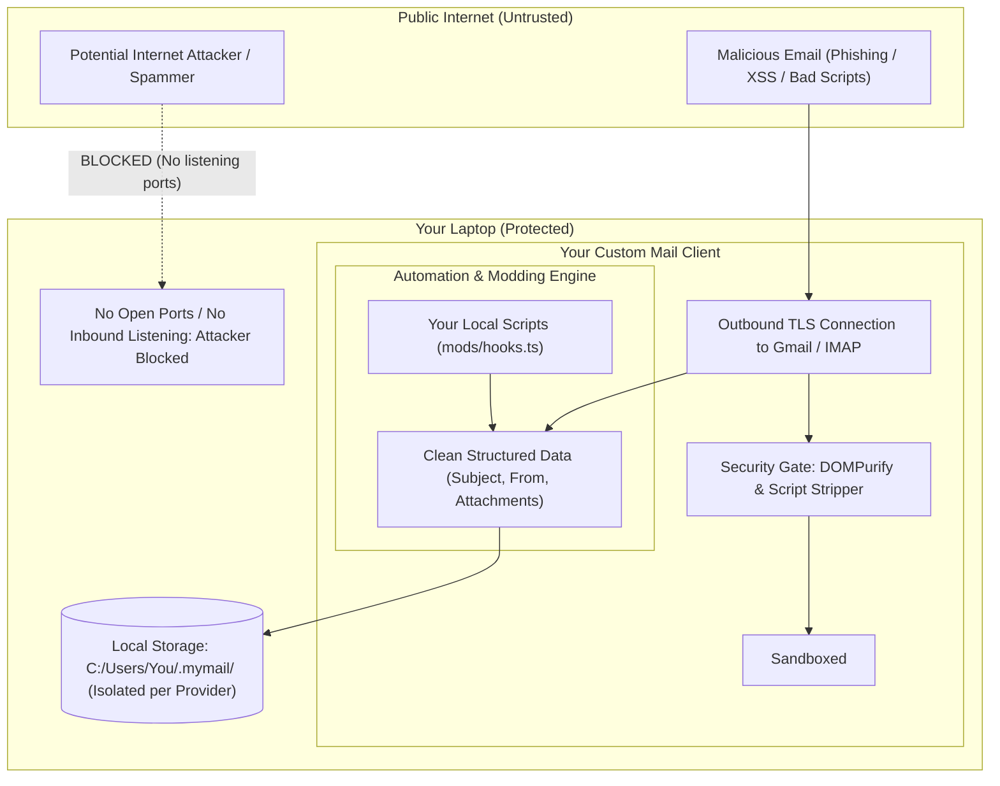

> **Links:** [[../../Welcome|Project root]] | [[overview|Topic Overview]] | [[../../../Style DNA|Style DNA]] | [[../../../../Welcome|Vault index]]
> **Session Chain:** [[session_01_feasibility-and-architecture-breakdown|Session 01]] -> [[session_02_provider-isolation-and-moddable-architecture|Session 02]] -> **Session 03 (Current)**

# Session 03: Tech Stack Selection and Security Threat Model

**Topic:** [[overview|Self Coded Mail Client]]  
**Date:** 2026-10-17 23:56  
**Participants:** User, AI Assistant  
**Focus:** Determining the recommended tech stack and breaking down the security model: local hackability/automation vs network attack vectors.  

---

## 1. Executive Summary & Breakthroughs
- **The Core User Concern:** 
  1. What exact tech stack should be used to build this?
  2. If the client is made "hackable" / moddable with automation, **can someone on the internet hack the user's laptop**, or does the hackability stay strictly isolated on the local machine?
- **The Security Verdict:** **Nobody on the internet can hack your laptop through your mail client** because a desktop email client is **outbound-only**—it does *not* listen on any public open ports on the internet. "Hackable" in developer terms means **user-customizable/scriptable by YOU**, not vulnerable to cybercriminals.
- **The Real Threat Model:** The only potential vector is malicious content inside incoming emails (malicious HTML, JavaScript, tracking pixels, or infected attachments). By implementing **strict sandboxing (DOMPurify + locked iframe)** and **treating email data as passive text strings**, your laptop remains 100% secure.
- **The Tech Stack Recommendation:** **Electron + TypeScript + Vite + SQLite (with FTS5)** for the fastest build and easiest automation scripting, OR **Tauri v2 + Rust** if absolute minimal RAM (<40MB) is preferred.

---

## 2. Spoken Conversation & Dialogue Transcript

### User
> "My main question: what is the tech stack I should use? The moddable thing was basically automation, also the hackable layer—tell me about it. Like if I make it, would it be hackable by anyone on the net or just on my laptop? I need to know about it."

### Assistant
> "Let's put your mind completely at ease on this right away:
> 
> **1. Nobody on the internet can reach or hack your laptop just because you built this.**
> There is a huge difference between a public server and a desktop client:
> - A **Server** (like an Apache web server or Minecraft server) opens a public port to the internet and listens for incoming connections. If it has a bug, random hackers on the web can scan and attack it.
> - A **Desktop Email Client** (like Thunderbird or your app) **NEVER listens for incoming connections**. It only makes **outbound encrypted connections** (TLS) to Gmail or Outlook to fetch your mail, just like when you open your web browser. To the outside internet, your laptop has zero open doors.
> 
> **2. What 'Hackable' Actually Means Here:**
> When developers say 'we will make it hackable,' we mean **hackable by YOU, locally**—meaning we won't lock you out of your own software like Microsoft does. You have the freedom to drop in a script that says 'if an email is from Amazon, save the PDF invoice to `C:/Invoices`.'
> 
> **3. The ONLY Security Rule You Must Follow:**
> The only way outside data enters your app is the *content of an email*. If a spammer sends an email with malicious JavaScript, we simply **strip all scripts** and render the email in a locked sandbox so it can never run code on your laptop.
> 
> **4. For the Tech Stack:**
> If you want automation scripts to be easy and enjoyable to write, **TypeScript + Node/Electron + SQLite** is hands-down the best choice."

---

## 3. Core Concepts & Ideation Details

### 3.1 The Security Architecture & Threat Model



### 3.2 Threat Analysis Table

| Threat Vector | Can It Happen? | How We Prevent It |
|---|---|---|
| **Remote Network Attack (Port Scanning)** | **NO** (Impossible) | The client makes outbound TLS requests only. It never opens inbound listening network sockets. |
| **Malicious JavaScript in Email (XSS)** | Possible if careless | We sanitize all HTML with `DOMPurify` and render inside `<iframe sandbox="allow-same-origin">` with `allow-scripts` turned **OFF**. |
| **Malicious Attachments (`.exe` / `.bat`)** | Possible if clicked | The app never auto-runs attachments. They are saved passively to disk with OS security flags intact. |
| **Tracking Pixels / Spy Beacons** | Common in marketing emails | Remote images are blocked by default. The client only loads images if you click "Show Images". |
| **Credential Theft** | Possible if stored in plain text | Passwords and OAuth tokens are stored inside the **Windows Credential Manager (DPAPI)** or macOS Keychain via the OS keyring API. |
| **Automation Injection** | Only if using `eval()` | Your automation rules process data passively (e.g. `subject.includes("Invoice")`). We never execute untrusted strings as code. |

---

## 4. Tech Stack Comparison: Which Should You Use?

### The Contenders

```
┌─────────────────────────────────────────────────────────────────────────────┐
│ OPTION 1: Electron + TypeScript + Vite + TailwindCSS + SQLite (FTS5)        │
│ • Verdict: BEST FOR FAST DEVELOPMENT & EASY AUTOMATION                      │
│ • Why: Massive ecosystem of existing email libraries; scripts are in JS/TS. │
│ • Memory: ~200MB - 300MB RAM (smooth on modern computers).                 │
└─────────────────────────────────────────────────────────────────────────────┘

┌─────────────────────────────────────────────────────────────────────────────┐
│ OPTION 2: Tauri v2 + Rust + React/Svelte + SQLite                           │
│ • Verdict: BEST FOR EXTREME EFFICIENCY & LOWEST RAM                         │
│ • Why: Uses the OS native webview; binary is tiny (~15MB), RAM is ~40MB.    │
│ • Memory: ~40MB RAM. Requires writing backend logic in Rust.                │
└─────────────────────────────────────────────────────────────────────────────┘
```

### Detailed Tech Stack Matrix

| Criteria | Stack 1: Electron + TypeScript (Recommended) | Stack 2: Tauri v2 + Rust | Stack 3: Python (PyQt / Custom) |
|---|---|---|---|
| **Ease of Building** | ⭐⭐⭐⭐⭐ Easiest & fastest | ⭐⭐⭐ Moderate (Rust learning curve) | ⭐⭐⭐ Good for backend, clunky UI |
| **Email Protocol Support** | ⭐⭐⭐⭐⭐ `imapflow`, `mailparser`, `nodemailer` (Superb) | ⭐⭐⭐⭐ `async-imap`, `lettre` (Good) | ⭐⭐⭐⭐ `imaplib`, `email` |
| **Automation / Modding** | ⭐⭐⭐⭐⭐ Native JavaScript/TypeScript hooks | ⭐⭐⭐ Requires embedding Lua/JS engine | ⭐⭐⭐⭐⭐ Native Python scripts |
| **RAM Usage** | ~200MB – 300MB (Reasonable) | **~35MB – 50MB (Ultra-light)** | ~100MB – 150MB |
| **Local Database** | `better-sqlite3` + FTS5 (Instant search) | `rusqlite` + FTS5 (Instant search) | `sqlite3` + FTS5 |
| **UI Aesthetics** | HTML/CSS/Tailwind (Unlimited modern design) | HTML/CSS/Tailwind (Unlimited modern design) | Qt Widgets or QML (Dated/Harder) |

---

## 5. Recommended Architecture: The "Modular TypeScript Engine"

If you choose **Electron + TypeScript + Vite**:

1. **Frontend (The UI):**
   - **React or Svelte** with **TailwindCSS**: Clean 3-pane layout, dark mode, smooth transitions, instant keyboard navigation.
2. **Backend / Main Process:**
   - **Protocol Engine:** `imapflow` (modern, robust, supports IMAP IDLE push notifications).
   - **MIME Parser:** `mailparser` (effortlessly parses attachments, inline images, and weird encodings).
   - **Persistence:** `better-sqlite3` (synchronous, sub-millisecond local queries with full-text search).
   - **Credentials:** `keytar` (stores tokens directly in Windows Credential Manager).
3. **Modding & Automation Engine:**
   - A `mods/` directory monitored by a file-watcher.
   - User writes plain JavaScript/TypeScript functions that receive `{ email, provider, attachments }`.
   - Built-in helper APIs: `saveAttachment(path)`, `moveToFolder(name)`, `sendNotification(title, body)`.

---

## 6. Decisions Made & Action Items
- [x] Clarified the security model: Outbound-only TLS connections mean zero network attack surface from the internet.
- [x] Defined email sanitization rules (DOMPurify, disabled JavaScript, blocked remote images).
- [x] Selected **Electron + TypeScript + Vite + TailwindCSS + SQLite (FTS5)** as the top recommendation for solo developer velocity and easy scripting.
- [ ] Finalize user preference between Stack 1 (Electron/TS) and Stack 2 (Tauri/Rust).
- [ ] Outline the project scaffolding structure and first working prototype script.

---

## 7. Context Continuity & Next Session Agenda
- **Pointers for next session:** 
  1. Once you confirm the tech stack, we can scaffold the exact project structure.
  2. Write a minimal 50-line Node.js script to test connecting to your email provider over IMAP and fetching your latest 5 emails safely.
- **Related Sessions:** [[session_01_feasibility-and-architecture-breakdown|Session 01]], [[session_02_provider-isolation-and-moddable-architecture|Session 02]]
