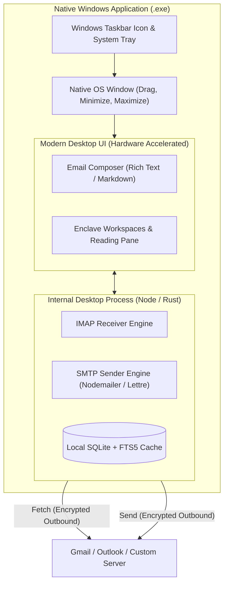
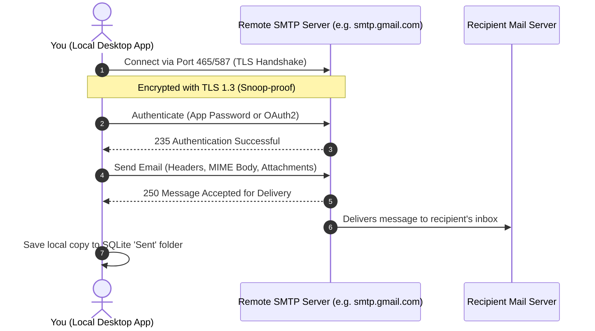

> **Links:** [[../../Welcome|Project root]] | [[overview|Topic Overview]] | [[../../../Style DNA|Style DNA]] | [[../../../../Welcome|Vault index]]
> **Session Chain:** [[session_01_feasibility-and-architecture-breakdown|Session 01]] -> [[session_02_provider-isolation-and-moddable-architecture|Session 02]] -> [[session_03_tech-stack-selection-and-security-threat-model|Session 03]] -> **Session 04 (Current)**

# Session 04: Desktop App Architecture and Outbound SMTP Security

**Topic:** [[overview|Self Coded Mail Client]]  
**Date:** 2026-10-17 23:59  
**Participants:** User, AI Assistant  
**Focus:** Clarifying desktop .exe packaging vs web apps, outbound email sending via SMTP, and the security model of the sending pipeline.  

---

## 1. Executive Summary & Breakthroughs
- **Question 1: Are we making a web app or a desktop app?**
  - **Verdict:** **100% a native Desktop Application (`.exe`)**. It sits in your Windows taskbar, has its own window, works completely offline, and runs directly on your computer. Web tech (HTML/CSS) is used purely to render the UI inside a desktop wrapper (exactly how Discord, Spotify, VS Code, and Obsidian are built).
- **Question 2: Can we send emails from it too?**
  - **Verdict:** **YES, absolutely.** You get a full email composer (To, Cc, Bcc, Subject, Markdown / Rich Text, Attachments). It dispatches outgoing mail via **SMTP (Simple Mail Transfer Protocol)**.
- **Question 3: Is the sending side hackable by people on the internet?**
  - **Verdict:** **NO.** Sending an email is an **outbound TLS-encrypted pipeline**. Your computer reaches out to the provider (e.g. `smtp.gmail.com`); no outside connections are accepted. Every byte, attachment, and password is encrypted in transit.

---

## 2. Spoken Conversation & Dialogue Transcript

### User
> "So you are saying a web? Can't we make a desktop app? Also can I send email from it too, and also the sending side—is that hackable too?"

### Assistant
> "Let's clear up that confusion immediately:
> 
> **1. It IS 100% a Desktop App (an `.exe` file on your laptop):**
> You are NOT making a website that you visit in Google Chrome. You are building an installable desktop program that has its own icon in your Windows taskbar, its own desktop window, works offline, and stores data on your hard drive. 
> 
> The reason we mentioned HTML/CSS is because almost all modern desktop software today—including **Discord, Spotify, VS Code, Obsidian, and Slack**—uses web UI inside a desktop shell like **Electron** or **Tauri**. It compiles into a standard `.exe` on Windows.
> 
> **2. Yes, you can send emails just like Thunderbird:**
> You get a full 'Compose Email' window where you type messages, attach files, format text, and click Send. The app connects over **SMTP** to your email provider, which delivers the message anywhere in the world in seconds.
> 
> **3. Is the sending side hackable?**
> No! Just like receiving, sending is an **outbound-only connection**. When you hit Send:
> - Your laptop opens an encrypted TLS connection (port 465 or 587) directly to your mail provider.
> - Everything you send (password, message body, attachments) is locked with high-grade cryptography.
> - Nobody on your Wi-Fi, your ISP, or the internet can spy on it, tamper with it, or hack into your laptop."

---

## 3. Core Concepts & Ideation Details

### 3.1 Desktop App Packaging Model

### 3.2 The Sending Pipeline (SMTP over TLS)

When you write and send an email from your desktop app, here is the exact sequence:

1. **Composition & Validation:**
   - You type the email in the local composer.
   - Attachments are read from your local hard drive and converted into MIME format.
2. **Secure Handshake (STARTTLS / SSL):**
   - The desktop app initiates a secure connection to the provider's SMTP server (e.g. `smtp.gmail.com:465`).
   - Certificates are verified to prevent Man-in-the-Middle (MitM) attacks.
3. **Authenticated Dispatch:**
   - Your stored credentials (or OAuth2 token) authenticate your account.
   - The email payload is transmitted over the encrypted tunnel.
4. **Sent Folder Synchronization:**
   - The app automatically uploads a copy to your provider's `[Gmail]/Sent Mail` or `Sent Items` folder via IMAP, and caches it locally in your isolated SQLite database.

---

## 4. Security Breakdown of the Sending Side

| Security Concern | The Fear | The Reality & Defense |
|---|---|---|
| **Can hackers on my Wi-Fi steal my email or password?** | Packet sniffing / eavesdropping. | **Impossible.** The connection uses TLS (Transport Layer Security) encryption. An eavesdropper only sees scrambled cryptographic noise. |
| **Can anyone on the internet hack into my laptop during send?** | Inbound network penetration. | **Impossible.** You are connecting OUT to the server. Your computer never opens a listening port. |
| **Can someone alter or tamper with my email in flight?** | Man-in-the-Middle (MitM) modification. | **Prevented.** TLS has cryptographic integrity checks. If any packet is modified, the connection terminates instantly. Furthermore, the mail provider signs the outbound email with **DKIM (DomainKeys Identified Mail)**. |
| **Can someone spoof my email address?** | Identity forgery. | Modern mail servers reject unauthorized sender addresses. You can only send as the authenticated user. |

---

## 5. Decisions Made & Action Items
- [x] Confirmed the application is **100% a native Desktop Application (`.exe`)** running locally, not a website.
- [x] Confirmed the sending engine is fully supported via **SMTP over TLS**.
- [x] Verified that the sending pipeline has zero inbound exposure and is cryptographically protected against tampering and eavesdropping.
- [ ] Scaffold the local project structure with Electron + TypeScript + Vite.
- [ ] Build a test script to send a test email and verify SMTP connectivity.

---

## 6. Context Continuity & Next Session Agenda
- **Pointers for next session:** 
  1. Initialize the project repository with Electron + TypeScript + Tailwind.
  2. Create the first working prototype with a 3-pane layout, workspace switcher, and an email composer.
- **Related Sessions:** [[session_01_feasibility-and-architecture-breakdown|Session 01]], [[session_02_provider-isolation-and-moddable-architecture|Session 02]], [[session_03_tech-stack-selection-and-security-threat-model|Session 03]]
