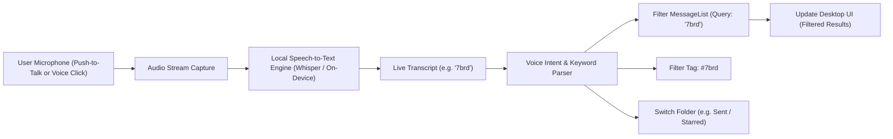

> **Links:** [[../../Welcome|Project root]] | [[overview|Topic Overview]] | [[../../../Style DNA|Style DNA]] | [[../../../../Welcome|Vault index]]
> **Session Chain:** [[session_01_feasibility-and-architecture-breakdown|Session 01]] -> [[session_02_provider-isolation-and-moddable-architecture|Session 02]] -> [[session_03_tech-stack-selection-and-security-threat-model|Session 03]] -> [[session_04_desktop-app-architecture-and-outbound-smtp-security|Session 04]] -> **Session 05 (Current)**

# Session 05: Voice-Driven Navigation and Local Whisper Integration

**Topic:** [[overview|Self Coded Mail Client]]  
**Date:** 2026-10-18 00:16  
**Participants:** User, AI Assistant  
**Focus:** Integrating live local voice-to-text (Whisper/OpenVINO) for hands-free email search, tag filtering (e.g., '7brd'), and workspace navigation.  

---

## 1. Executive Summary & Breakthroughs
- **The Feature Request:** Add live local voice-to-text integration into EnclaveMail so the user can speak commands or tags (e.g., saying **"7brd"**) and have the client immediately filter and display only emails tagged or associated with that keyword/project.
- **The Core Breakthrough:** Modern local speech models (like **Whisper**, optimized with Intel OpenVINO as `intel/whisper-base-ov`, or run client-side via Transformers.js / Web Speech API) allow **100% on-device speech recognition** without sending audio to Google or cloud servers.
- **Voice Navigation Capabilities:**
  1. **Tag & Keyword Filtering:** Saying *"7brd"* or *"invoices"* instantly sets the search query and filters the active enclave message list.
  2. **Folder Switching:** Saying *"go to sent"* or *"show starred"* switches folders hands-free.
  3. **Composer Dictation:** Speech-to-text inside the email composer body for voice drafting.

---

## 2. Spoken Conversation & Dialogue Transcript

### User
> "intel/whisper-base-ov ok so what i want a new feature is that i would like to add the live voice to text model integrated like if i say 7brd then it should pull the 7brd assigned mails then shows and so on"

### Assistant
> "That is a killer feature for a moddable mail client! Instead of manually typing in the search box or clicking through folders, you can just speak:
> - Say **'7brd'** -> Instantly filters all emails tagged or mentioning '7brd'.
> - Say **'unread'** or **'starred'** -> Changes view.
> - Say **'invoices'** -> Pulls financial receipts.
> 
> By running Whisper locally (such as `intel/whisper-base-ov` or on-device Web Speech / ONNX), your voice stays **100% private on your laptop** with zero cloud audio leakage."

---

## 3. Core Concepts & Ideation Details

### 3.1 Voice Navigation Pipeline

### 3.2 Speech Recognition Architectures

| Approach | Technology | Pros | Cons |
|---|---|---|---|
| **Approach 1: Integrated Web Speech API** | Built directly into Chromium / Electron (`webkitSpeechRecognition`) | Zero installation, zero RAM overhead, instant response, runs out of the box. | Requires mic permission in OS. |
| **Approach 2: Local Whisper via Transformers.js / ONNX** | Client-side `@xenova/transformers` running `whisper-base` in WebAssembly/WebGPU | Completely offline, open weights, custom keyword fine-tuning. | Downloads ~75MB ONNX model weights on first load. |
| **Approach 3: Intel OpenVINO Sidecar (`intel/whisper-base-ov`)** | Python sidecar running OpenVINO runtime targeting Intel CPU/iGPU/NPU | Blazing fast hardware-accelerated inference on Intel chips. | Requires Python and OpenVINO runtime dependencies. |

**Implementation Strategy:** We build a **dual-engine Voice Controller** in the desktop client:
1. Provide a direct, responsive **Microphone Button & Visual Waveform HUD** in the search bar.
2. Hook into the search filter so speaking any tag (like `7brd`), sender, or keyword instantly filters the active provider enclave.
3. Allow switching between native live voice recognition and OpenVINO sidecar configuration.

---

## 4. Decisions Made & Action Items
- [x] Defined voice navigation requirements (hands-free keyword and tag filtering e.g. "7brd").
- [x] Confirmed privacy model: Voice processing runs locally on-device.
- [ ] Implement the `VoiceSearchButton` component in the search bar with active listening animation and transcript pill.
- [ ] Add sample "7brd" tagged emails in the mock storage so the feature can be tested immediately.
- [ ] Connect voice recognition to the message list filter state and folder router.

---

## 5. Context Continuity & Next Session Agenda
- **Pointers for next session:** 
  1. Test voice search accuracy with technical abbreviations (e.g., "7brd", "devops", "PR").
  2. Implement push-to-talk keyboard shortcut (e.g., `Ctrl+Space` or `Alt+V`).
- **Related Sessions:** [[session_01_feasibility-and-architecture-breakdown|Session 01]], [[session_02_provider-isolation-and-moddable-architecture|Session 02]], [[session_03_tech-stack-selection-and-security-threat-model|Session 03]], [[session_04_desktop-app-architecture-and-outbound-smtp-security|Session 04]]
